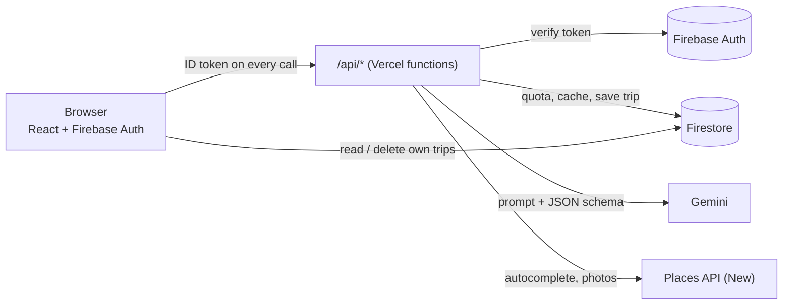

# TripForge · AI Travel Planner

Tell the app where you are going, for how many days, with what budget and who. It plans hotels and a day-by-day itinerary with Gemini and shows real photos from Google Places. Trips are private to your Google account.

> **Live demo:** [musafir-ai-mu.vercel.app](https://musafir-ai-mu.vercel.app/) &nbsp;|&nbsp; **GitHub:** [github.com/PrathamRj3162/tripforge](https://github.com/PrathamRj3162/tripforge)

Built by **Pratham Raj**. Architecture and flow designed with React, Gemini, and Firebase. The server proxy, Firebase Auth, Firestore rules, AI-output validation, quota, caching, tests and CI are custom engineering additions.

## What it does

- Sign in with Google (Firebase Authentication).
- Search a destination with autocomplete (Places API (New), called through the server).
- Generate a plan: summary, 4-5 hotels, and 3-4 places per day, validated before it is saved.
- Photos for the destination, hotels and places, with the photographer credit Google requires.
- My Trips: list and delete your saved trips. Nobody else can read them.
- Repeat requests are answered from a shared cache without using AI quota.

## Architecture



Generating a trip, step by step:

1. The browser sends `POST /api/generate-trip` with the user's Firebase ID token.
2. `server/auth.js` verifies the token with the Admin SDK. The user id comes from the token, never from the request body.
3. `server/input.js` validates and cleans the input (days 1-7, known budget and traveler ids, destination reduced to plain place-name characters).
4. `server/tripService.js` looks for the same request in the shared cache (`tripCache`). A hit costs no AI quota.
5. On a miss it takes one unit of the daily quota in a Firestore transaction (per user and for the whole app).
6. It calls Gemini with the prompt and a JSON schema (`server/gemini.js`).
7. The reply is normalised and validated with Zod (`server/tripSchema.js`). If it fails, there is one repair retry, then the next model in the fallback list. If everything fails, the quota unit is refunded.
8. The validated plan is cached and saved to `users/{uid}/trips/{autoId}` by the server.
9. The browser reads that document directly from Firestore, which the security rules allow only for its owner.

## Security model

| Risk | What this project does | Where |
|---|---|---|
| Database open to everyone | Rules: only the owner can read or delete a trip, nobody can write from the browser, server-only collections are fully locked, everything else is denied | `firestore.rules` |
| API keys visible in the browser | Gemini, Places and the service account exist only in server environment variables. The browser calls `/api/*`. `npm run audit:bundle` searches `dist/` for the real secret values and fails if it finds one | `server/`, `api/`, `scripts/audit-bundle.mjs` |
| Fake login (profile in browser storage) | Firebase Auth. Each request carries a signed ID token that the server verifies. Editing anything in the browser cannot change who the server thinks you are | `server/auth.js`, `src/context/AuthContext.jsx` |
| Untrusted AI output | Normalise, then validate against a strict schema. Unknown keys are dropped, no AI-supplied URLs are used, invalid replies are never stored | `server/tripSchema.js` |
| Prompt injection through the destination | The destination is reduced to letters, numbers and a few punctuation marks, limited to 100 characters, quoted as data in the prompt, and the model context holds no secrets or tools. React escapes all text | `server/input.js`, `server/prompt.js` |
| Cost abuse | Exact daily quota (per user and global) in Firestore, a burst limiter, a shared cache, request size limits, a bounded function time | `server/quota.js`, `server/rateLimit.js`, `server/cache.js`, `vercel.json` |
| Guessable trip links | Trips use Firestore auto IDs under the owner's uid | `server/trips.js` |
| Errors leaking internals | Unknown errors return a generic message with a request id. Details go only to the server log | `server/http.js` |

## Design decisions and trade-offs

- **Server-only writes.** Trips are created by the Admin SDK, so only validated data is ever stored. The price is a service account key to protect and a little more setup than letting the browser write directly.
- **One schema, two jobs.** The same Zod schema is turned into JSON Schema for Gemini and used to validate the reply. Gemini rejects schemas it finds complex, so the version sent to it keeps only types, required fields and descriptions. Lengths, ranges and counts are enforced after the reply arrives.
- **Shared cache.** Identical requests share one plan. That saves quota and time, but two people asking for the same trip get the same text. The "brand-new plan" checkbox bypasses the cache and costs one AI plan.
- **Two kinds of rate limiting.** The daily AI quota is exact (Firestore transaction). The burst limiter for autocomplete and photos is in memory, per serverless instance, so it is best effort. Redis would make it exact.
- **Photos are looked up on demand.** Google's photo references expire, so they are not stored. A lookup goes through the server and is cached in memory and in the browser.
- **Handlers are plain `Request` to `Response` functions** (`export default { fetch }`). The same file runs on Vercel, in the local dev bridge (`scripts/dev-api.mjs`) and in unit tests. Dependencies are injected, so tests need no Google account.

## Known limitations and next steps

- Firestore rules are checked by hand (see below), not by automated emulator tests.
- No browser end-to-end tests yet. Playwright would be the next step.
- No Firebase App Check, no strict Content-Security-Policy.
- AI plans can contain mistakes. The app says so, and every place links to Google Maps.
- Gemini free-tier limits are shown in AI Studio and can change. Model names change often: `npm run doctor -- --models` lists what your key can use.
- Trips cannot be shared (private by design). Sharing would need a signed link or a `sharedWith` field plus rules.

## Tech stack

React 18, Vite 5, Tailwind CSS 3, React Router 6, Firebase Auth + Firestore, Firebase Admin SDK, Gemini (`@google/genai`), Places API (New), Zod, Vercel Functions, Node's built-in test runner, GitHub Actions.

## Getting started

Requirements: Node.js 20 or newer, a Google account.

```bash
npm install
cp .env.example .env.local      # Windows: copy .env.example .env.local
```

### 1. Firebase

1. [console.firebase.google.com](https://console.firebase.google.com) > Add project (Analytics not needed).
2. Build > Authentication > Get started > Sign-in method > Google > Enable.
3. Build > Firestore Database > Create database. Pick a region near you and start in production mode.
4. Project settings > General > Your apps > Web (`</>`) > Register app. Copy `apiKey`, `authDomain`, `projectId` and `appId` into the four `VITE_FIREBASE_*` lines of `.env.local`.
5. Project settings > Service accounts > Generate new private key. Run `npm run encode:sa -- path/to/key.json`, paste the single line it prints into `.env.local`, then move or delete the JSON file. It must never be committed.
6. Firestore Database > Rules: paste the contents of `firestore.rules` and Publish.

### 2. Gemini

[aistudio.google.com/apikey](https://aistudio.google.com/apikey) > Create API key > put it in `GEMINI_API_KEY`.

### 3. Places

Use a Google Cloud project that has billing enabled (it can be a different project from Firebase, so Firebase can stay on the free plan). Enable **Places API (New)**, create an API key, restrict it to *Places API (New)* only, and put it in `GOOGLE_PLACES_API_KEY`. A daily quota cap and a budget alert are worth setting.

### 4. Check and run

```bash
npm run doctor            # checks .env.local, never prints a secret
npm run doctor -- --live  # also tries each key against the real service
npm run dev               # app and /api on http://localhost:5173
```

## Environment variables

| Variable | Runs in | Required | Default | Purpose |
|---|---|---|---|---|
| `VITE_FIREBASE_API_KEY` | browser | yes | | Identifies your Firebase web app (public, not a secret) |
| `VITE_FIREBASE_AUTH_DOMAIN` | browser | yes | | `<project>.firebaseapp.com` |
| `VITE_FIREBASE_PROJECT_ID` | browser | yes | | Firebase project id |
| `VITE_FIREBASE_APP_ID` | browser | yes | | Firebase web app id |
| `GEMINI_API_KEY` | server | yes | | Gemini key |
| `GEMINI_MODEL` | server | no | `gemini-3.8-flash` | Main model |
| `GEMINI_FALLBACK_MODELS` | server | no | `gemini-3.5-flash-lite` | Comma-separated, tried in order |
| `GEMINI_THINKING_LEVEL` | server | no | `low` | `low`, `medium`, `high` or `off` |
| `GOOGLE_PLACES_API_KEY` | server | yes | | Places API (New) key |
| `PLACES_AUTOCOMPLETE_TYPES` | server | no | `(cities)` | Empty means any place |
| `FIREBASE_SERVICE_ACCOUNT_BASE64` | server | yes | | From `npm run encode:sa` |
| `DAILY_TRIP_LIMIT` | server | no | `8` | AI plans per user per UTC day |
| `GLOBAL_DAILY_TRIP_LIMIT` | server | no | `40` | AI plans for the whole app per UTC day. Keep it below your Gemini quota |
| `CACHE_TTL_HOURS` | server | no | `168` | How long a cached plan is reused |

Never put a `VITE_` prefix on a server value: everything with that prefix is shipped to every visitor.

## Scripts

| Command | What it does |
|---|---|
| `npm run dev` | Vite dev server with `/api` served from the same port |
| `npm test` | All unit tests (Node's built-in runner, no network) |
| `npm run build` | Production build into `dist/` |
| `npm run audit:bundle` | Fails if a secret or a direct Gemini/Places call is in `dist/` |
| `npm run check` | Tests, build and bundle audit (what CI runs) |
| `npm run doctor` | Environment preflight (`-- --live`, `-- --models`) |
| `npm run encode:sa -- file.json` | Turns the service account JSON into one env line |

## Deploy to Vercel

1. Push the repository to GitHub and import it in Vercel (the Vite preset is detected).
2. Add every variable from the table above in Project > Settings > Environment Variables. Mark the server secrets as sensitive.
3. Deploy. Then, in Firebase > Authentication > Settings > Authorized domains, add your `*.vercel.app` domain (and any custom domain). Without this, the Google sign-in popup is refused.
4. Smoke test:

```bash
curl -i https://YOUR-APP.vercel.app/api/health                 # 200 {"ok":true}
curl -i -X POST https://YOUR-APP.vercel.app/api/generate-trip  # 401 unauthenticated
```

5. Optional cleanup of old counters and cache entries (they carry an `expiresAt` field):

```bash
gcloud firestore fields ttls update expiresAt --collection-group=tripCache --enable-ttl --project=YOUR_PROJECT
gcloud firestore fields ttls update expiresAt --collection-group=usage --enable-ttl --project=YOUR_PROJECT
```

## Testing

`npm test` runs the suite with no network and no Google account. It covers input validation and prompt building, schema validation and repair, the Gemini JSON schema conversion, the quota transaction (limits, day rollover, refund), the cache key and expiry, the whole trip service (cache hit, fallback, repair, refund, time budget), every handler (401, 405, 400, 413, 415, 429, 500 and the happy path), the Places client, the Gemini caller, the local dev bridge, and project-level checks that stop drift (undeclared packages, undocumented env vars, open Firestore rules, secrets in browser code).

Not covered by automated tests: real Google, Firebase and Gemini calls, the Firestore rules themselves, and the browser UI.

Check the rules by hand in Firebase > Firestore > Rules > Rules Playground:

| Simulation | Expected |
|---|---|
| `get` `/users/ALICE/trips/x`, signed in as `ALICE` | Allowed |
| the same path, signed in as `BOB` | Denied |
| the same path, signed out | Denied |
| `create` `/users/ALICE/trips/new`, signed in as `ALICE` | Denied |
| `get` `/usage/anything` or `/tripCache/anything`, signed in | Denied |

## Project structure

```
api/            Vercel entry points (3 lines each)
server/         All backend logic: auth, validation, schema, quota, cache, Gemini, Places
  handlers/     One file per endpoint
shared/         Limits used by both browser and server
src/            React app (pages, components, Firebase and API clients)
scripts/        doctor, bundle audit, key encoder, local /api bridge
tests/          Unit tests and small fakes
docs/           STUDY_GUIDE.md: file-by-file notes and interview questions
firestore.rules Security rules
vercel.json     Rewrites, security headers, function time limit
.agents/        Antigravity rules and workflows
```

## Credits

Original project architecture & concept by Pratham Raj. Photos come from Google Places and are credited in the app.
